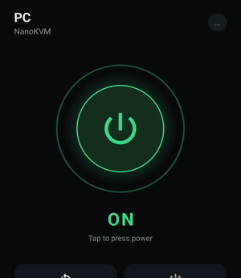
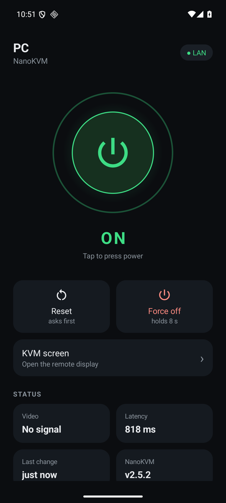
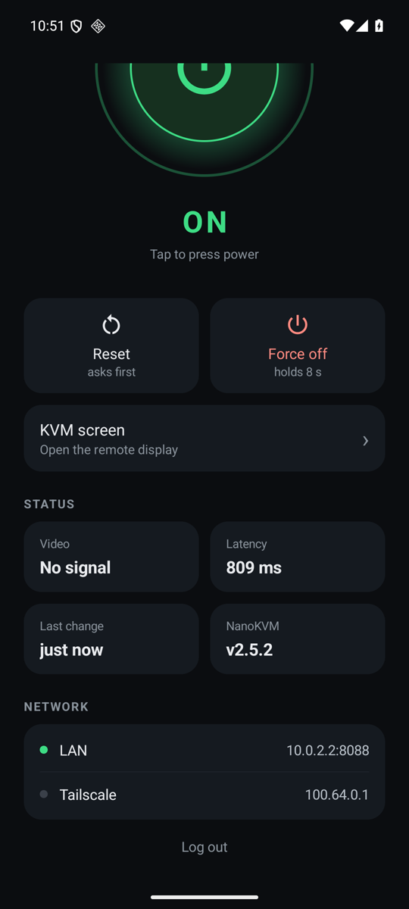
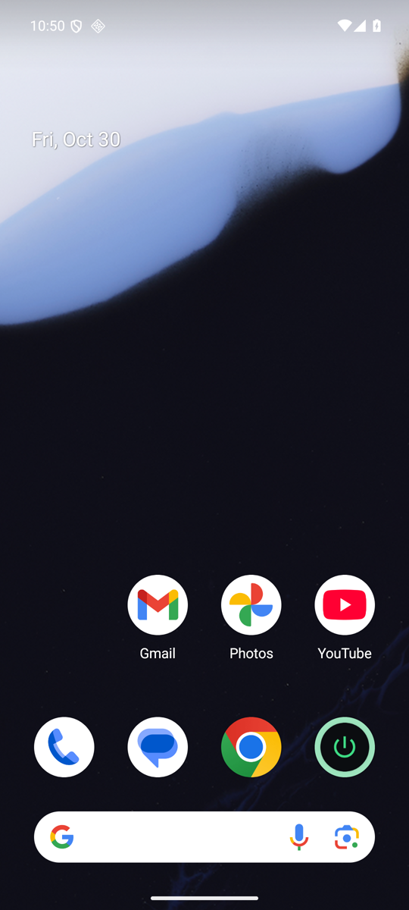
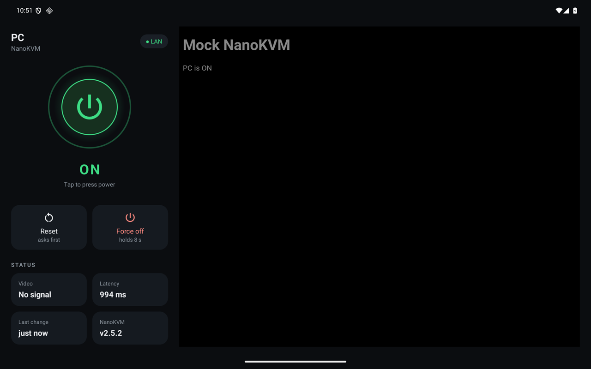

# NanoKVM for Android

Control a PC through its [Sipeed NanoKVM](https://github.com/sipeed/NanoKVM) from your phone or tablet, at home or
remotely over Tailscale: see whether it's on, press power or reset, force it off, and open the KVM screen.

<p>



</p>



## Features
- **Power:** tap the big button for a short power press, which also wakes the PC. It glows and pulses green while
  the PC is on. Reset and Force off (an 8 s hold) have their own buttons and ask first.
- **Status:** on/off from the power LED, HDMI signal, latency, last state change, NanoKVM version.
- **Finds the NanoKVM itself:** scans your Wi-Fi for it on first launch, and learns its Tailscale address after
  login. When the LAN address stops answering it falls back to Tailscale, and rescans if the address changed.
- **KVM screen:** the NanoKVM web UI, already logged in.
- **Widgets:** 1x1 power, 2x1 status + power, 4x1 status + power + reset + screen. Tap the text to refresh.
- **Tablet layout:** controls on the left, the KVM screen on the right.
- **Animations:** state changes, press feedback and screen entrances; they follow Android's animation settings.

Requires Android 12+ and a NanoKVM running app 2.5 or later (multi-user API). Tested with the NanoKVM PCIe.
Wake from off needs the NanoKVM to stay powered while the PC is off (the PCIe version does).

## Install
With [Obtainium](https://github.com/ImranR98/Obtainium): **Add app** → `https://github.com/7tg/nanokvm-android`.
It picks up new releases automatically. Or download the APK from [Releases](https://github.com/7tg/nanokvm-android/releases).

On first launch the app searches your Wi-Fi for the NanoKVM and fills in its address; enter it yourself (LAN IP or
Tailscale name) if it isn't found. Then log in with a NanoKVM account.

## Security
NanoKVM has no API keys, only username/password login with a session cookie. The app stores the password
encrypted with an Android Keystore key, so it can log in again when the session (31 days by default) expires.
It talks plain HTTP to the NanoKVM like the web UI does; use it on your LAN or over Tailscale, not the open internet.

## How it works
- Status: `GET /api/vm/gpio` (`pwr` = power LED). Buttons: `POST /api/vm/gpio` `{"type":"power"|"reset","duration":ms}`.
- Login: `POST /api/auth/login` with the password CryptoJS-AES encrypted, as the web UI sends it.
- Tailscale address: `GET /api/extensions/tailscale/status`. Video: `GET /api/vm/hdmi`. Version: `GET /api/vm/info`.
- LAN discovery: probes the phone's Wi-Fi /24 for a page titled `NanoKVM`.

## Build
```
JAVA_HOME=/path/to/jdk-21 ./gradlew assembleDebug
```
Release builds (`assembleRelease`) are minified and signed with the key from `keystore.properties`; without that file
they use the debug key. The app has no dependencies: framework Views, `HttpURLConnection` and a WebView.

## Development
No hardware needed: `python3 tools/mock_nanokvm.py` (needs `cryptography`) runs a fake NanoKVM on port 8088
with a PC that turns on and off. In the emulator, log in to `10.0.2.2:8088` as `admin` / `admin`.
Wi-Fi discovery can't see the mock, so test that on a real device. Tablet layout on a phone emulator:
`adb shell wm size 2560x1600 && adb shell wm density 320`.

## Releases
Pushing a `v*` tag makes GitHub Actions build a signed APK and attach it to a GitHub release
(`versionName` = tag without `v`, `versionCode` = run number). Other pushes build a debug APK as a workflow artifact.
Secrets: `KEYSTORE_BASE64`, `KEYSTORE_PASSWORD`, `KEY_ALIAS`.
